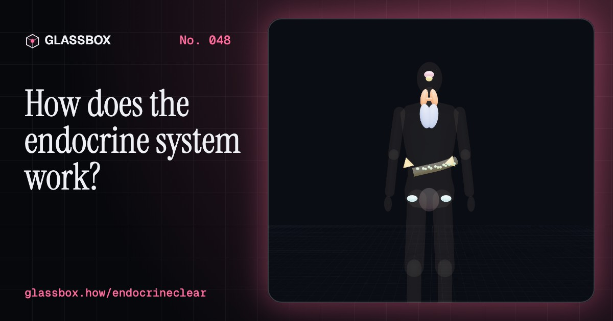
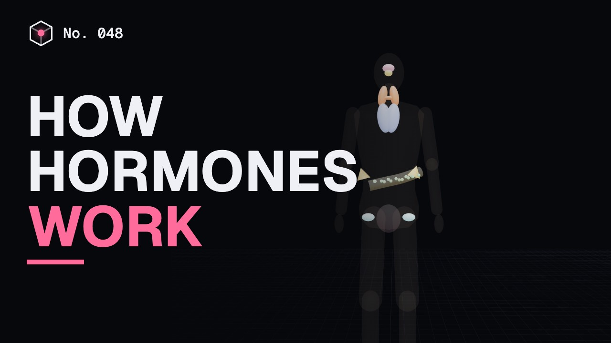
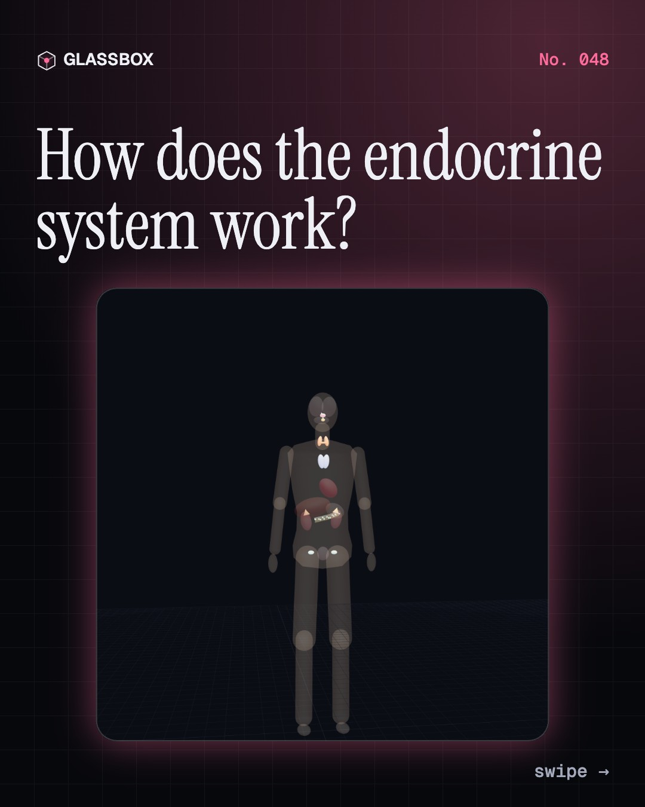
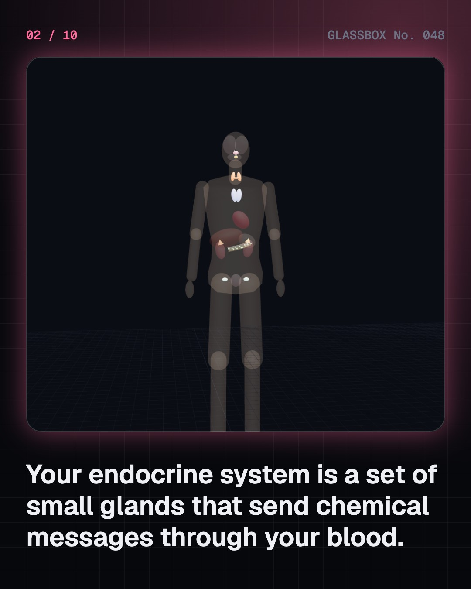
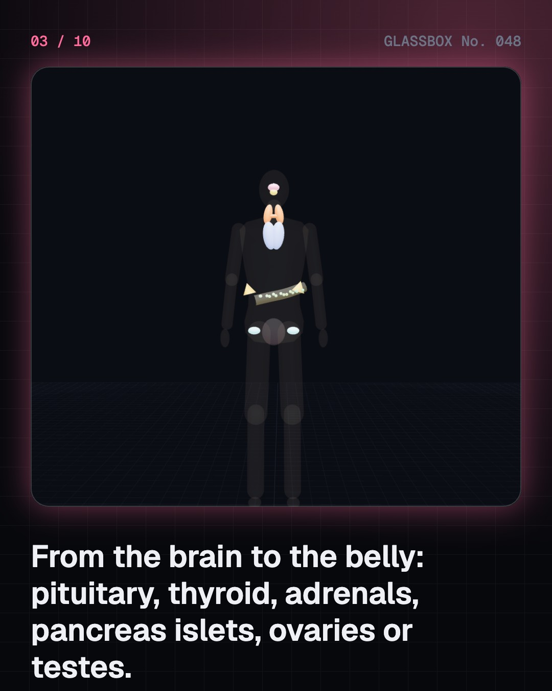
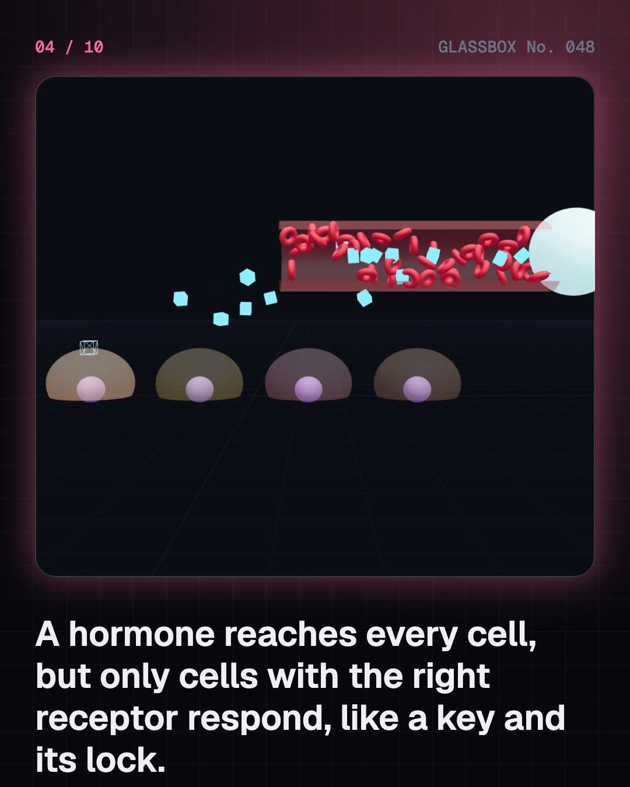

<!-- glassbox:start -->
<!-- Generated from glassbox.json by the Glassbox hub (npm run readme -- endocrineclear). Edit glassbox.json, not this block. -->
<p align="center"><a href="https://glassbox.how/e/endocrineclear/"></a></p>

<h1 align="center">EndocrineClear</h1>

<p align="center"><b>How does the endocrine system work?</b><br>Nine small glands, from a pea under your brain to the islets in your pancreas, run your body by sending chemical messages in the blood. Watch only the cells with the right lock respond, kick a hormone and see negative feedback pull it back, race a nerve against a hormone, and grow a baby into an adult.</p>

<p align="center"><a href="https://glassbox.how/endocrineclear/"><b>▶ Play with it</b></a> &nbsp;·&nbsp; <a href="https://glassbox.how/e/endocrineclear/">Read the 60-second explainer</a> &nbsp;·&nbsp; <a href="https://glassbox.how/endocrineclear/glassbox/reel.mp4">Watch the 40-second video</a></p>

<p align="center">
  <a href="https://glassbox.how/e/endocrineclear/"></a>
  <a href="https://glassbox.how/e/endocrineclear/"></a>
  <a href="LICENSE"></a>
  <a href="LICENSE-CONTENT.md"></a>
  <a href="#privacy"></a>
</p>

## In 60 seconds

1. **Glands with no tubes.** The hypothalamus, pituitary, pineal, thyroid, parathyroids, thymus, adrenals, pancreatic islets and ovaries or testes make more than 50 hormones. They pour them straight into the blood, which carries them round the body in about a minute.
2. **A key for the right lock.** Every cell meets every hormone, but only cells with the matching receptor respond. TSH wakes only the thyroid; thyroxine fits receptors in almost every cell. Nerves act in milliseconds; hormones in seconds to days, and can last for weeks.
3. **A thermostat in your head.** The hypothalamus tells the pituitary, and the pituitary tells the thyroid or adrenals. Their hormones travel back and switch the chain off: negative feedback. That is why a tired thyroid makes TSH climb, and why doctors test TSH.
4. **Sugar and stress.** After a meal insulin sends sugar into the liver and muscles; in a fast glucagon brings it back out, holding blood sugar near 70 to 100 mg/dL. In a scare, adrenaline arrives within seconds and cortisol peaks about half an hour later.
5. **Growing up.** Growth hormone, released mostly in deep sleep, and thyroid hormone grow you; GnRH, LH and FSH start puberty. Melatonin from the pineal signals night, and screens push it later. The thyroid needs iodine, which is why India iodises salt.
6. **When hormones go wrong.** About 101 million Indians have diabetes (ICMR-INDIAB, 2023) and about 1 in 10 adults has an underactive thyroid. Most hormone problems show up on a blood test and can be looked after well. If you are worried, see a doctor.

## Words worth knowing

| Term | Meaning |
|---|---|
| **Hormone** | A chemical message made by a gland and carried by the blood to cells elsewhere. |
| **Endocrine gland** | A gland with no duct that releases its hormones straight into the blood. |
| **Receptor** | A protein on or in a cell that one hormone fits, like a lock and its key. |
| **Pituitary** | The pea-sized master gland under the brain whose hormones switch other glands on. |
| **Hypothalamus** | The part of the brain that controls the pituitary and links nerves to hormones. |
| **Negative feedback** | When a hormone's rise turns down its own supply, holding the level steady. |
| **Insulin and glucagon** | Islet hormones that lower and raise blood sugar. |
| **Adrenaline and cortisol** | Fast and slower stress hormones from the adrenal glands. |
| **Goitre** | A swollen thyroid, most often from too little iodine. |

## A short history

**From seaweed for swollen necks to insulin made by bacteria: 2,500 years of learning how glands talk through the blood.**

- **1849** · The rooster experiment (Arnold Adolph Berthold, Göttingen, Germany)
- **1855** · A disease of the adrenal glands (Thomas Addison, Guy's Hospital, London, England)
- **1902** · Secretin: the first hormone (William Bayliss and Ernest Starling, University College London, England)
- **1905** · The word hormone is born (Ernest Starling, Royal College of Physicians, London, England)
- **1914** · Thyroxine crystals on Christmas Day (Edward Kendall, Mayo Clinic, Rochester, Minnesota, USA)
- **1922** · Insulin saves a boy's life (Frederick Banting, Charles Best, J.J.R. Macleod and James Collip, University of Toronto, Canada)
- **1955** · The brain is the boss of the pituitary (Geoffrey Harris, with Dora Jacobsohn, Cambridge and London, England, and Lund, Sweden)
- **1960** · Measuring a hormone in a drop of blood (Rosalyn Yalow and Solomon Berson, Bronx Veterans Administration Hospital, New York, USA)

The full story, with 30 moments, charts, people and 52 sources: [glassbox.how/e/endocrineclear/history](https://glassbox.how/e/endocrineclear/history/). The data lives in [`history.json`](history.json).

## Video and slides

Made with the Glassbox studio from this box's storyboard (`window.glassbox.director`). Free to reuse under CC BY 4.0.

<a href="https://glassbox.how/endocrineclear/glassbox/video.mp4"></a>

<p><a href="glassbox/slide-1.jpg"></a> <a href="glassbox/slide-2.jpg"></a> <a href="glassbox/slide-3.jpg"></a> <a href="glassbox/slide-4.jpg"></a></p>

| File | What | Size |
|---|---|---|
| [`glassbox/reel.mp4`](https://glassbox.how/endocrineclear/glassbox/reel.mp4) | Reel / Short, with captions and soundtrack | 1080×1920 |
| [`glassbox/video.mp4`](https://glassbox.how/endocrineclear/glassbox/video.mp4) | YouTube video, with captions and soundtrack | 1920×1080 |
| `glassbox/slide-1…10.jpg` | Instagram carousel | 1080×1350 |
| `glassbox/thumb.jpg` | YouTube thumbnail | 1280×720 |
| `glassbox/cover.jpg` | Share card and repo social preview | 1200×630 |
| [`glassbox/history-reel.mp4`](https://glassbox.how/endocrineclear/glassbox/history-reel.mp4) | “History in 10 moments” Reel / Short | 1080×1920 |
| `glassbox/history-slide-*.jpg` | History carousel | 1080×1350 |
| `glassbox/post.json` | Post copy and schedule used by the publish kit | |

## Privacy

This box has no accounts and no ads, and it ships its own fonts and libraries. When you run it yourself it sends nothing anywhere. On glassbox.how, the site's `/bar.js` also loads Glassbox's analytics: **Google Analytics** to count visits (it asks first in the EU, UK and Switzerland, and stays off when your browser sends Global Privacy Control or Do Not Track) and **ClickTrust** to detect bots.

It remembers a few things **in your own browser only**, and never sends them anywhere:

| Browser storage key | What it holds |
|---|---|
| `endocrineclear.v1` | Which chapters you have opened, your best quiz scores, and sound on or off. |

Exactly what each one sees is at [glassbox.how/privacy](https://glassbox.how/privacy/).

## Licences

- **Code:** [MIT](LICENSE). Use it, change it, ship it.
- **Explanations, text, images and videos** (`glassbox.json`, `glassbox/`): [CC BY 4.0](LICENSE-CONTENT.md). Credit “Glassbox, glassbox.how/e/endocrineclear”.
- **Third-party parts** keep their own licences: [three.js](https://threejs.org) (MIT), [Geist, Instrument Serif](https://openfontlicense.org) (SIL OFL 1.1).
- The Glassbox name and logo aren't covered by either licence. See the [terms](https://glassbox.how/terms/).

Found a mistake? [Open an issue](https://github.com/bdeeps/endocrineclear/issues). Corrections happen in public.
<!-- glassbox:end -->

## Run it

It's plain HTML, CSS and JavaScript. No build step and no dependencies. Run locally, it contacts no other website.

```bash
python3 -m http.server 8000
```

Three.js and the fonts ship in `vendor/` and `fonts/`, so it also works offline.

Then open http://localhost:8000.

## How it's built

| File | What |
|---|---|
| `index.html`, `css/app.css` | The page and its styles |
| `js/app.js`, `js/stage.js`, `js/ui.js`, `js/kit.js` | The shared Glassbox 3D engine: chapters, 3D stage, controls, quiz, video director |
| `js/chapters/*.js` | One file per chapter: the 3D model, controls, text, key terms, quiz and video scenes |
| `js/endo.js` | The ghosted body with the nine endocrine glands, hormone particle flows, chart boards, the thyroid feedback loop at rest and the WHO growth curves, with sources |
| `glassbox.json` | Title, question, explainer beats, key terms, browser storage and credits shown on glassbox.how |
| `reel` in each chapter | The storyboard the Glassbox studio records into short videos |
| `glassbox/` | The published video, slides, thumbnail and post copy |
| `fonts/`, `vendor/three/` | Self-hosted Geist and Instrument Serif (SIL OFL 1.1) and three.js (MIT) |
